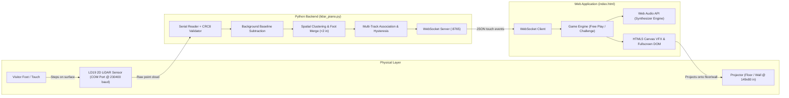

# Pulse Piano (K1) — Interactive Music Wall & Floor Piano

[](LICENSE)
[](https://www.python.org/)
[](https://developer.mozilla.org/en-US/docs/Web/API/Web_Audio_API)
[](https://websockets.readthedocs.io/)
[](#hardware-devices--screens)

> **Touch a wall or step on a giant floor keyboard to play notes, melodies, and sound effects.**  
> An inviting, low-latency musical installation for all ages—ideal for learning musical scales, guided melody games, or creating joyful shared moments in public and commercial spaces.

---

## 🎹 Overview

**Pulse Piano (K1)** transforms any ordinary floor or wall surface into a responsive, oversized interactive piano. Using a high-precision 2D LiDAR sensor (LD19) paired with an ultra-low-latency Web Audio engine, visitors can trigger rich polyphonic notes simply by stepping or tapping anywhere within the mapped projection zone.

The system features:
- **Zero-lag Web Audio Synthesizer**: Custom multi-harmonic additive synth with dynamic low-pass filtering and envelope shaping—no heavy external VSTs or sound banks required.
- **Intelligent Foot & Toe Tracking**: Dual-stage clustering and spatial hysteresis (merges points within 2 inches) to prevent jitter and duplicate triggers.
- **Background Subtraction**: Auto-calibration baseline capture to filter out permanent floor unevenness, walls, and ambient fixtures.
- **Two Built-in Play Modes**:
  1. **Free Play**: Open, expressive jam session with real-time note feedback and canvas particle effects.
  2. **Guided Challenge ("Happy Birthday")**: Interactive musical tutor with sequential golden target highlights, phrase lyrics, and automated celebratory replay loops.
- **Fullscreen Projection Mode**: Edge-to-edge, zero-border display configured for standard 149″ × 80″ floor or wall projections.
- **Hardware-Free Simulation**: Built-in mouse demo mode to test, develop, and present without needing physical sensors connected.

---

## 🏛️ Target Industries & Where It Fits

| Industry | Typical Venues | Experience Delivered |
|---|---|---|
| **Entertainment & Family Entertainment Centers (FEC)** | Theme parks, indoor playgrounds, game zones | High-energy musical obstacle and jump challenges |
| **Education & Preschools** | Schools, kindergartens, music academies | Kinesthetic ear-training, scale visualization, and rhythm games |
| **Museums & Heritage** | Science centers, children's discovery museums | Interactive physics of sound & acoustics exhibit |
| **Retail & Experiential Spaces** | Shopping malls, flagship retail stores | Immersive brand activation and foot-traffic magnet |
| **Public & Smart Cities** | Metro stations, civic plazas, libraries | Joyful community interventions and transit-station engagement |
| **Airports & Transport Hubs** | Passenger terminals, waiting lounges | Stress-relief and entertaining dwell-time activities |

---

## 👥 How People Use It

- **Child / Commuter / Casual Visitor**: Walk, jump, or tap on the projected keys. Visitors can freestyle their own melodies or follow the golden glowing keys to play classic tunes step-by-step.
- **Educator / Facilitator**: Host group music lessons, demonstrate note pitches (from F4 to A5), teach diatonic scales, and coordinate collaborative ensemble play among students.

---

## 💡 Client ROI & Value Proposition

- **High Joy, Low Overhead**: Operates autonomously on standard consumer PC hardware, standard commercial projectors, and affordable LiDAR sensors.
- **Draws Large Crowds**: Natural spectator appeal; attracts crowds in high-traffic corridors and increases dwell time.
- **Accessibility & Inclusion**: No physical controllers, wearables, or sanitization needed—anyone of any height or ability can participate.
- **Measurable Engagement**: Easy to track interactions, including:
  - **Plays per hour**
  - **Visitor dwell time**
  - **Social media mentions and user-generated video shares**

---

## 🛠️ Technology Stack & Architecture

### System Architecture



### Build Stack Details

- **Hardware**:
  - **Sensor**: LD19 2D LiDAR (360° TOF, 4500Hz sampling rate, 12m range) connected via USB-UART serial.
  - **Display**: High-lumen ultra-short-throw projector or high-resolution LED wall/floor.
  - **Audio**: External PA or stereo speakers connected to host PC.
  - **Compute**: Standard PC running Windows 10/11, macOS, or Linux.
- **Software**:
  - **Backend**: Python 3.9+, `pyserial`, `websockets`, `tkinter`.
  - **Frontend**: HTML5, Vanilla JavaScript (ES6+), Web Audio API, Canvas 2D.
- **Skills Required for Development / Extension**:
  - **Audio Engineer / Sound Designer**: Tuning synth harmonics, envelope attacks/decays, custom soundscapes.
  - **Creative Technologist**: Interactive installation design, TouchDesigner / Notch / WebGL integration.
  - **Embedded & Electronics Engineer**: Serial protocol optimization, sensor mounting, geometric calibration.

---

## 🎹 Piano Zone & Scale Mapping

The interactive area spans **149 inches** horizontally, featuring two **4-inch protective dead zones** at each end and **10 active diatonic keys** (14.1 inches per key):

| Lane ID | Musical Note | Frequency (Hz) | Visual Hex Color |
|:-------:|:------------:|:--------------:|:----------------:|
| **A** | F4 | 349.23 Hz | `#F7BA78` |
| **B** | G4 | 392.00 Hz | `#63DBFA` |
| **C** | A4 | 440.00 Hz | `#B4A1FF` |
| **D** | B4 | 493.88 Hz | `#6EE9B7` |
| **E** | C5 | 523.25 Hz | `#FF9EB7` |
| **F** | D5 | 587.33 Hz | `#88DFF7` |
| **G** | E5 | 659.25 Hz | `#EED388` |
| **H** | F5 | 698.46 Hz | `#D5A8FF` |
| **I** | G5 | 783.99 Hz | `#A8EB91` |
| **J** | A5 | 880.00 Hz | `#FFAE92` |

---

## 🚀 Quick Start Guide

### 1. Prerequisites
- **Python 3.9+** installed on your system.
- Modern web browser (Chrome, Edge, or Firefox).

### 2. Clone the Repository
```bash
git clone https://github.com/<YOUR_USERNAME>/<YOUR_REPO_NAME>.git
cd <YOUR_REPO_NAME>
```

### 3. Install Dependencies
```bash
pip install -r requirements.txt
```

### 4. Run the LiDAR Backend
Connect your LD19 sensor to your PC (check Device Manager for your COM port, default is `COM7` in `lidar_piano.py`):
```bash
python lidar_piano.py
```
> [!TIP]
> If your sensor is on a different port (e.g. `COM3` on Windows or `/dev/ttyUSB0` on Linux), open `lidar_piano.py` and update line 38: `PORT = "COM7"`.

### 5. Launch the Web Interface
Open `index.html` in your browser, or serve it locally using Python:
```bash
python -m http.server 8000
```
Navigate to `http://localhost:8000` in your web browser.

1. Click **Enable Audio** (or anywhere on the screen).
2. Click **⛶ Projection Mode** to enter borderless fullscreen on your projector screen.
3. Switch between **Free Play** and **Birthday Challenge** using the top menu.

---

## ⌨️ Studio Controls & Hotkeys

When the `lidar_piano.py` calibration window is active, you can use the following keyboard shortcuts:

| Key | Function |
|:---:|:---|
| <kbd>D</kbd> | **Toggle Mouse Simulation Mode** (click and drag to test footsteps without hardware) |
| <kbd>C</kbd> | **Capture Background** (samples empty floor baseline to filter ambient clutter) |
| <kbd>H</kbd> | **Toggle Info HUD** (shows connection status, FPS, packet stats, and tracks) |
| <kbd>G</kbd> | **Toggle Measurement Grid** (10-inch reference grid overlay) |
| <kbd>M</kbd> | **Mirror X-Axis** (inverts orientation if sensor is mounted opposite) |
| <kbd>↑</kbd> / <kbd>↓</kbd> | **Adjust Sensor Y-Offset** (fine-tune sensor position along the floor depth) |
| <kbd>←</kbd> / <kbd>→</kbd> | **Adjust Sensor Forward Angle** (fine-tune rotation in 1-degree increments) |
| <kbd>R</kbd> | **Reconnect Serial Port** |
| <kbd>F11</kbd> | **Toggle Fullscreen Window** |

---

## 📂 Repository Structure

```text
Pulse-Piano-V2/
├── index.html            # Web Audio engine, responsive visual piano UI, challenge modes & particle VFX
├── lidar_piano.py        # Python LiDAR serial reader, noise filter, tracking algorithm & WebSocket hub
├── requirements.txt      # Python dependencies (pyserial, websockets)
├── .gitignore            # Git exclusion rules
└── README.md             # Project documentation and deployment guide
```

---

## 📄 License

This project is licensed under the [MIT License](LICENSE).

